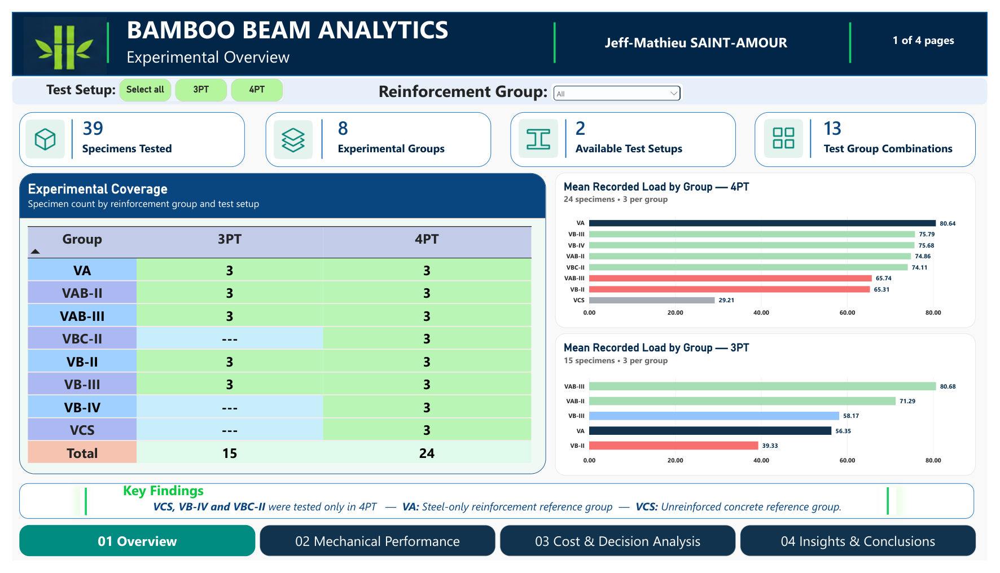
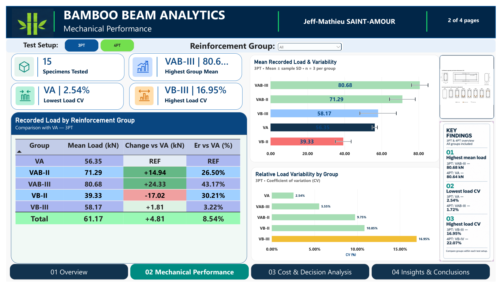
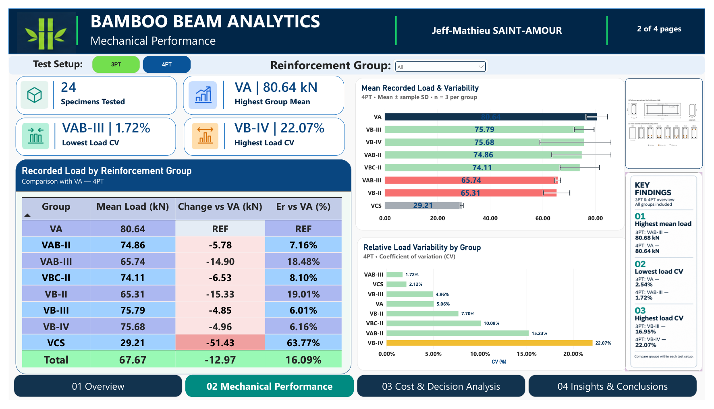
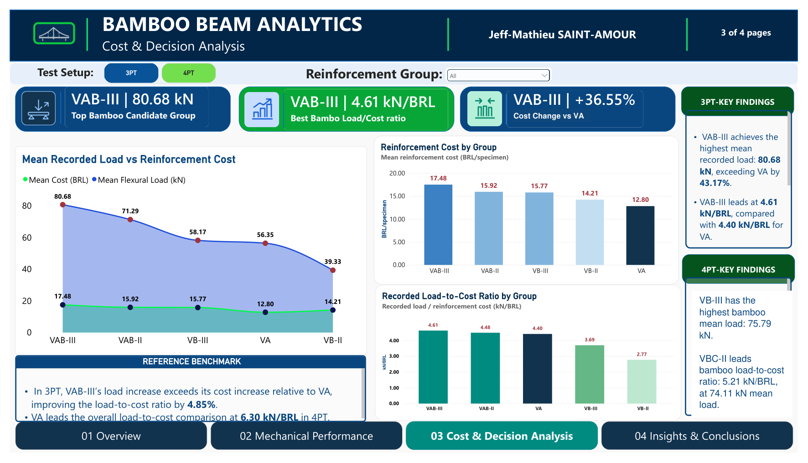
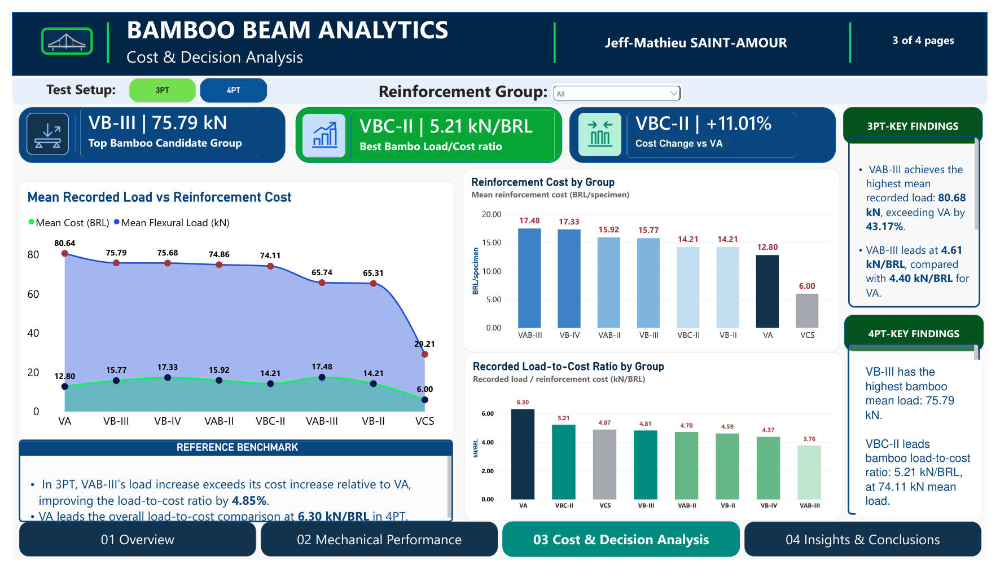
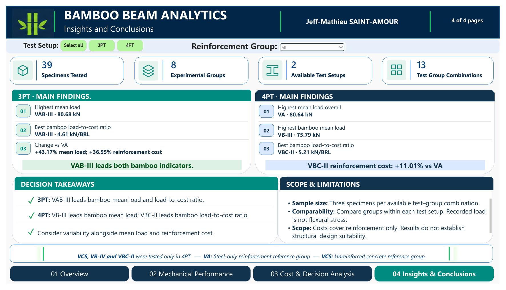

# Bamboo Beam Analytics

**Experimental flexural loads, reinforcement costs, and transparent analytical methods.**

**Jeff-Mathieu Saint-Amour** · Data Analyst · Civil Engineer · PhD Student in Production Engineering

[Report gallery](#report-gallery) · [Full Power BI report PDF](reports/Bamboo_Beam_Experimental_Analysis.pdf) · [Python notebook](notebooks/Bamboo_Beam_Experimental_Analysis.ipynb) · [Scientific synthesis](docs/scientific-synthesis.md) · [Methodology](docs/methodology.md) · [SQL analysis](sql/Bamboo_Beam_Analysis_Queries.sql)

## Collaborative research and data availability

This project was developed through collaborative research. This portfolio presents the data analysis workflow and selected aggregate findings; it does not claim sole authorship or ownership of the experimental dataset.

**The underlying experimental data are not publicly distributed while the associated scientific work is being prepared.** Access may be considered upon reasonable request, subject to agreement among the research collaborators and relevant data custodians, institutional requirements, and publication arrangements. [Data availability and access conditions](docs/data-availability.md).

## Project overview

This project connects experimental civil engineering data with a reproducible analytical workflow. It evaluates how reinforcement configurations relate to recorded flexural load, variability, and reported reinforcement cost, while keeping three-point and four-point bending tests separate.

The analysis covers **39 specimens**, **8 experimental groups**, **2 test setups**, and **13 available test–group combinations**, with **3 specimens per combination**. Python and SQLite provide the analytical foundation; a four-page Power BI report communicates the results.

## Research objectives

- Which configurations achieve the highest group mean load within each test setup?
- Which groups exhibit the lowest and highest relative load variability?
- How do candidates compare with the steel-only VA and unreinforced VCS references?
- Which configurations offer favorable load-to-cost ratios?
- How do candidate rankings change under explicit load and cost weights?
- Do specimen records, independent statistics, and SQL calculations reconcile?

## Main results

| Indicator | 3PT | 4PT |
|---|---|---|
| Specimens tested | 15 | 24 |
| Available experimental groups | 5 | 8 |
| Highest overall group mean | **VAB-III · 80.68 kN** | **VA · 80.64 kN** |
| Highest bamboo-containing group mean | **VAB-III · 80.68 kN** | **VB-III · 75.79 kN** |
| Best bamboo-containing load-to-cost ratio | **VAB-III · 4.61 kN/BRL** | **VBC-II · 5.21 kN/BRL** |
| Lowest load CV, all available groups | VA · 2.54% | VAB-III · 1.72% |
| Highest load CV | VB-III · 16.95% | VB-IV · 22.07% |
| Leading candidate under 50/50 normalized load–cost weights | VAB-II · score 0.6249 | VBC-II · score 0.9198 |

**Ratio leaders and weighted-score leaders are different concepts.** The raw ratio divides mean load by mean reinforcement cost. The weighted score combines separately normalized load and cost criteria. A leader under one rule need not lead under the other.

### Interpretation

In **3PT**, VAB-III records a 43.17% higher mean load than VA at a 36.55% higher reported reinforcement cost. Its load-to-cost ratio is approximately 4.85% higher than VA's. VAB-II leads the separate 50/50 decision scenario.

In **4PT**, VA leads overall mean load and overall load-to-cost ratio at 6.30 kN/BRL. Among bamboo-containing candidates, VB-III leads mean load and VBC-II leads the raw ratio. VBC-II's reported reinforcement cost is 11.01% higher than VA's, while its mean load is 8.10% lower. Its candidate-only ratio leadership therefore does not establish an advantage over the steel reference.

These comparisons support experimental interpretation and further investigation; they do not establish structural design suitability.

## Experimental coverage

| Group | Configuration recorded in the model | 3PT | 4PT |
|---|---|---:|---:|
| VCS | Unreinforced reference | — | 3 |
| VA | Steel-only reference, 0.68% nominal steel | 3 | 3 |
| VAB-II | 0.68% steel; two bamboo splints, 2.08% bamboo | 3 | 3 |
| VAB-III | 0.68% steel; three bamboo splints, 3.12% bamboo | 3 | 3 |
| VB-II | 0.51% steel; two bamboo splints, 2.08% bamboo | 3 | 3 |
| VB-III | 0.51% steel; three bamboo splints, 3.12% bamboo | 3 | 3 |
| VB-IV | 0.51% steel; four bamboo splints, 4.16% bamboo | — | 3 |
| VBC-II | 0.51% steel; two bamboo splints, 2.08% bamboo | — | 3 |

VB-II and VBC-II remain distinct recorded groups. Equal nominal ratios do not identify treatment differences. An unavailable experimental combination is not a zero measurement.

## Workflow and contribution

| Stage | Analytical work |
|---|---|
| Source preparation | Six-sheet Excel structure, preserved identifiers and measurement units; authorized CSV exports as an alternative input. |
| Python | Integrity controls, descriptive statistics, reference comparisons, Pareto analysis, weighted scenarios, sensitivity, and figures. |
| SQLite | Normalized experimental tables, live analytical views, foreign-key checks, and independent SQL reconciliation. |
| Power BI | Experimental coverage, mechanical performance, reinforcement cost comparisons, candidate indicators, and conclusions. |
| Documentation | Source fingerprints, metric definitions, data dictionary, model measures, and scope limitations. |

## Report gallery

The Power BI report has **four logical pages**. The PDF contains **six views**, because mechanical performance and cost analysis are exported for both test selections.

### 01 · Overview

Experimental inventory, test–group coverage, and within-test mean loads are shown in the opening image.

### 02 · Mechanical Performance

Specimen distributions, means with sample SD, relative variability, and comparison with VA.

### 03 · Cost & Decision Analysis

Reported reinforcement costs, load-to-cost ratios, bamboo-containing candidate indicators, and reference benchmarks.

### 04 · Insights & Conclusions

A synthesis of distinct 3PT and 4PT findings, decision takeaways, and experimental limits.

Two editorial corrections were applied to the portfolio PDF: the duplicated 4PT findings panel now reports the 4PT results, and “Cost Savings vs VA” is labeled “Cost Change vs VA.” See the [report notes](docs/report-notes.md). The supplied PBIX files are excluded from this repository.

## Methodological transparency and execution

The [notebook](notebooks/Bamboo_Beam_Experimental_Analysis.ipynb), SQL schema, analytical queries and DAX definitions document the methods. Execution requires separately authorized input data. The public notebook has no saved cell outputs or embedded specimen-level figures.

The workflow was checked on 39 specimens, with independent statistical and SQL calculations. The original Excel summary-sheet reconciliation was not executed in CSV mode. [Execution requirements and validation scope](docs/reproducibility.md).

## Repository contents

| Location | Contents |
|---|---|
| `notebooks/` | Documented analytical notebook with saved outputs removed |
| `sql/` | Research queries and empty-table schema; no experimental inserts |
| `powerbi/` | 50 DAX measures extracted from the supplied model |
| `assets/` | Six selected aggregate report views |
| `reports/` | Portfolio copy of the six-view Power BI PDF |
| `docs/` | Methodology, data availability, dictionary, aggregate findings and validation scope |
| `scripts/` | Optional notebook execution entry point |

## Scope and limitations

Each available test–group combination has three specimens. Results are descriptive. Recorded kN loads are not flexural stress in MPa; support span and full protocol information are not established by these tables. Costs refer to reported reinforcement values, with detailed composition and price date unconfirmed. The analysis establishes no lifecycle cost, durability, environmental impact, code compliance, or structural design suitability.
